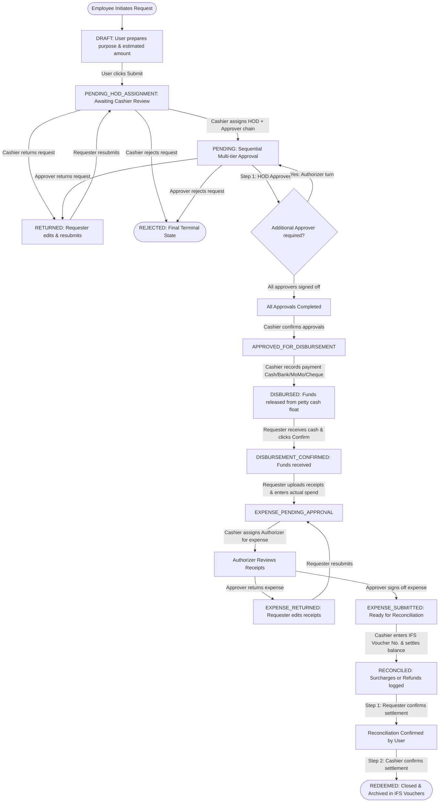

# IOU & Petty Cash Management System

> **A comprehensive, enterprise-grade web application for managing end-to-end petty cash requests, cash advances (IOUs), tiered multi-level approvals, multi-currency fund float disbursements, receipt settlements, and IFS ERP voucher reconciliation.**

---

## 📑 Table of Contents

1. [Executive Overview](#-executive-overview)
2. [Why This System Exists](#-why-this-system-exists)
3. [User Roles & Permissions Matrix](#-user-roles--permissions-matrix)
4. [Complete End-to-End Workflow (A to Z Flow)](#-complete-end-to-end-workflow-a-to-z-flow)
   - [Workflow State Diagram](#workflow-state-diagram)
   - [Phase-by-Phase Breakdown](#phase-by-phase-breakdown)
5. [IOU Lifecycle & Status Reference](#-iou-lifecycle--status-reference)
6. [Frontend Application Architecture & Pages](#-frontend-application-architecture--pages)
   - [Core User Views](#1-core-user-views)
   - [Approval & Financial Operation Views](#2-approval--financial-operation-views)
   - [Administration & Governance Views](#3-administration--governance-views)
7. [Key System Features & Cross-Cutting Capabilities](#-key-system-features--cross-cutting-capabilities)
   - [Active Directory / LDAP Authentication](#active-directory--ldap-authentication)
   - [IFS ERP Voucher Integration](#ifs-erp-voucher-integration)
   - [Multi-Currency Petty Cash Float Management](#multi-currency-petty-cash-float-management)
   - [Receipt Upload & Document Management](#receipt-upload--document-management)
   - [Automated Email & In-App Notifications](#automated-email--in-app-notifications)
   - [24-Hour Automated Expense Reminders](#24-hour-automated-expense-reminders)
   - [Tamper-Evident Audit Logging](#tamper-evident-audit-logging)
8. [Technology Stack](#-technology-stack)
9. [Project Structure](#-project-structure)
10. [Setup & Installation Guide](#-setup--installation-guide)
    - [Prerequisites](#prerequisites)
    - [Environment Configuration](#environment-configuration)
    - [Running Locally](#running-locally)
    - [Building for Production](#building-for-production)
11. [Troubleshooting & FAQs](#-troubleshooting--faqs)

---

## 🏢 Executive Overview

The **MPS IOU Manager** is the centralized corporate platform used by **Meridian Port Services (MPS)** to digitize, control, and audit the entire lifecycle of corporate petty cash advances and "I Owe You" (IOU) requisitions.

Before this platform, petty cash transactions relied on paper vouchers, manual sign-offs, physical receipts carried between offices, and offline reconciliation spreadsheets. This led to delays in expense clearance, untracked cash advances, and difficulty tying disbursements to official ERP journal vouchers.

The IOU Manager replaces all manual steps with a **fully digital, transparent, multi-tier approval and settlement engine**:
- Employees apply for cash advances with estimated budgets, currencies, and justifications.
- Cashiers review and assign the required departmental Head of Department (HOD) and tiered Authorizers.
- Approvers review sequentially according to company authority limits.
- Cashiers disburse funds using multiple payment channels (Cash, Bank Transfer, Mobile Money, Cheque) backed by real-time petty cash ledger tracking.
- Employees acknowledge receipt of funds and upload actual proof-of-purchase receipts.
- Any surplus funds returned or deficit reimbursements are reconciled.
- The transaction is linked to an official **IFS Applications ERP Voucher Number** and permanently archived with a full audit log.

---

## 🎯 Why This System Exists

| Challenge (Manual / Legacy) | Solution in MPS IOU Manager |
|-----------------------------|-----------------------------|
| **Delayed & Lost Paper Vouchers** | 100% cloud/intranet-based lifecycle with real-time status badges, tracking, and instant search. |
| **Bypassed Approvals & Unauthorized Spend** | Enforced sequential approval chains. Approvers cannot approve out of turn; approval limits are strictly respected. |
| **Untracked Cash Advances** | Cashiers and accountants have real-time visibility into every outstanding advance with an automated 24-hour reminder daemon. |
| **Float Discrepancies** | Multi-currency petty cash ledger (GHS, USD, EUR, GBP) tracking all credits, debits, disbursements, and reconciliation adjustments. |
| **Unsettled Receipts & Overspends** | Strict expense submission requiring attached invoices/receipts, side-by-side estimated vs. actual variance calculations, and two-step sign-off. |
| **ERP Disconnect** | Mandatory IFS Voucher Number recorded on reconciliation, with direct deep-linking to launch the IFS Explorer client. |

---

## 👥 User Roles & Permissions Matrix

The application enforces fine-grained Role-Based Access Control (RBAC):

| Role / Flag | Primary Responsibilities | Accessible Pages |
|-------------|--------------------------|------------------|
| **Requester (Employee)** | • Create IOU requests<br>• Edit Draft & Returned requests<br>• Acknowledge receipt of disbursed funds<br>• Submit actual expenses with receipts<br>• Confirm reconciliation | • Dashboard (personal stats)<br>• My Requests (`/ious`)<br>• Request IOU (`/ious/create`)<br>• IOU Details (`/ious/:id`) |
| **Head of Department (HOD)** | • Step 1 approval for departmental requisitions<br>• Review justifications and budget allocations<br>• Return requests for corrections or reject | • All Requester pages<br>• Approvals Queue (`/approvals`) |
| **Authorizer / Senior Approver** | • Step 2+ tiered approvals based on company authority limits<br>• Review and approve actual submitted expense reports<br>• Add feedback/comments | • All Requester pages<br>• Approvals Queue (`/approvals`)<br>• IFS Vouchers / Redeemed (`/redeemed`) |
| **Cashier (Finance / Petty Cash Custodian)** | • Assign HOD and Authorizer approval chains<br>• Reject or return inappropriate requests upfront<br>• Confirm completed approvals<br>• Disburse funds across payment methods<br>• Reconcile submitted receipts with disbursements<br>• Record IFS ERP voucher numbers<br>• Manage multi-currency petty cash floats | • All Requester & Approver pages<br>• All IOU Requests (`/ious`)<br>• Fund Management (`/fund-management`)<br>• Departments (`/admin/departments`)<br>• IFS Vouchers (`/redeemed`) |
| **System Administrator** | • Global governance and platform configuration<br>• User directory management & role assignment<br>• Department setup, HOD assignment, LDAP alias mapping<br>• Managed Approver directory & limit configuration<br>• Tamper-evident Audit Log monitoring<br>• System date limit settings | • Full system access across all 14 pages and administrative modules |

---

## 🔄 Complete End-to-End Workflow (A to Z Flow)

### Workflow State Diagram



---

### Phase-by-Phase Breakdown

#### Phase 1: Initiation & Draft Creation (`DRAFT`)
1. An employee navigates to **Request IOU** (`/ious/create`).
2. The user specifies:
   - **Purpose of Requisition**: Detailed business justification.
   - **Estimated Amount**: Projected cost.
   - **Currency**: `GHS` (Ghana Cedi), `USD` (US Dollar), `EUR` (Euro), or `GBP` (British Pound).
   - **Department**: Requester's organizational department.
   - **Attachments**: Proforma invoices, supplier quotes, memos, or flight itineraries.
3. The request is created in `DRAFT` status and can be freely updated or deleted.

#### Phase 2: Cashier Intake & Approver Assignment (`PENDING_HOD_ASSIGNMENT`)
1. The employee clicks **Submit for Approval**.
2. The request enters the Finance Cashier queue under `PENDING_HOD_ASSIGNMENT`.
3. The Cashier reviews the application:
   - **Assign Approvers**: The Cashier selects the employee's **Head of Department (Step 1)** (indicated with a `★` matching their department) followed by any senior **Authorizers (Step 2, Step 3, etc.)** based on financial threshold policies.
   - **Return for Edits**: If incomplete or details need clarification, the Cashier returns the IOU with comments.
   - **Reject**: If deemed invalid or against corporate policy, the Cashier rejects the request with an audit comment.

#### Phase 3: Sequential Multi-Tier Approval Chain (`PENDING`)
1. Once assigned, the request transitions to `PENDING`.
2. Approvals execute **strictly in order** (Step 1 → Step 2 → Step 3):
   - Only the approver whose step is active can take action; subsequent approvers must wait.
   - Automated emails notify each approver when it is their turn.
3. At each step, the designated approver can:
   - **Approve**: Advances the IOU to the next step.
   - **Return**: Returns the IOU to the requester with mandatory feedback. Downstream pending approvals are purged.
   - **Reject**: Permanently rejects the requisition with mandatory feedback.
4. When all assigned steps are marked `APPROVED`, the Cashier is prompted to **Confirm Approval**.
5. Once confirmed, status transitions to `APPROVED_FOR_DISBURSEMENT`.

#### Phase 4: Petty Cash Disbursement (`APPROVED_FOR_DISBURSEMENT` → `DISBURSED`)
1. The Cashier opens the IOU and selects **Disburse Funds**:
   - **Amount**: Automatically locked to the approved requisition amount.
   - **Payment Method**: Cash, Bank Transfer, Mobile Money, or Cheque.
   - **Payment Reference**: Transaction hash, cheque number, or receipt code.
   - **Notes**: Internal cashier disbursement memo.
2. When submitted:
   - The selected petty cash float balance is automatically debited.
   - A `DISBURSEMENT_DEBIT` ledger transaction is created in Fund Management.
   - Status updates to `DISBURSED`.
   - The requester receives an email alerting them that funds are available.

#### Phase 5: Fund Receipt Confirmation (`DISBURSEMENT_CONFIRMED`)
1. The requester collects the cash or verifies bank receipt.
2. The requester clicks **"✓ Confirm - I received the funds"**.
3. Status advances to `DISBURSEMENT_CONFIRMED`.
4. *Governance Rule*: The employee cannot submit an expense report until fund receipt is confirmed.

#### Phase 6: Expense Settlement & Receipt Submission (`EXPENSE_PENDING_APPROVAL`)
1. The employee executes the expenditure.
2. In **IOU Detail**, the employee accesses **Submit Expense**:
   - Enters **Actual Amount Spent**.
   - Adds expenditure notes explaining any variance.
   - Uploads mandatory **Proof-of-Purchase Receipts / Invoices**.
3. The system automatically computes the variance:
   - **Exact Match (`0.00`)**: Exact expenditure.
   - **Underspent (`-Amount`)**: Employee owes excess funds back to MPS Petty Cash.
   - **Overspent (`+Amount`)**: MPS owes employee a reimbursement for excess personal funds spent.
4. Status transitions to `EXPENSE_PENDING_APPROVAL`.

#### Phase 7: Expense Approval & Audit Sign-Off (`EXPENSE_SUBMITTED`)
1. The Cashier assigns an **Authorizer** to audit the submitted receipts and expenses.
2. The Authorizer inspects the receipts against the original purpose:
   - **Approve**: Approves the expense submission.
   - **Return / Reject**: Returns the expense report with feedback (`EXPENSE_RETURNED`). The employee modifies the figures or re-attaches clear receipts and re-submits.
3. Upon approval, status moves to `EXPENSE_SUBMITTED`.

#### Phase 8: Cashier Reconciliation & IFS ERP Voucher Linking (`RECONCILED`)
1. The Cashier reviews the verified expense and receipts.
2. Any cash balance is settled:
   - Underspent cash is deposited back into the petty cash float (`RECONCILIATION_ADJUSTMENT`).
   - Overspent balance is paid out to the employee.
3. The Cashier posts the transaction into the corporate ERP (**IFS Applications**) and inputs the mandatory **IFS Voucher Number** (e.g. `2026002038`).
4. Status advances to `RECONCILED`.

#### Phase 9: Two-Tier Redemption & Archival (`REDEEMED`)
1. **Requester Confirmation**: The employee reviews the final reconciliation summary and confirms that surplus cash was refunded or reimbursement was received.
2. **Cashier Confirmation**: Once the requester has confirmed, the Cashier submits final redemption.
3. Status transitions to `REDEEMED`.
4. The IOU is closed, locked against further edits, and permanently cataloged under **IFS Vouchers** (`/redeemed`).

---

## 📊 IOU Lifecycle & Status Reference

| Status Code | Badge Style | Description | Who Can Act | Next Possible States |
|-------------|-------------|-------------|-------------|----------------------|
| `DRAFT` | Slate | Request created by user; not yet submitted | Requester | `PENDING_HOD_ASSIGNMENT`, Deleted |
| `PENDING_HOD_ASSIGNMENT` | Indigo | Submitted by user; waiting for Cashier to assign approval chain | Cashier | `PENDING`, `RETURNED`, `REJECTED` |
| `PENDING` | Amber | Actively undergoing sequential HOD and Authorizer sign-offs | Active Step Approver | `APPROVED_FOR_DISBURSEMENT`, `RETURNED`, `REJECTED` |
| `RETURNED` | Yellow | Returned to requester due to missing data or queries | Requester | `PENDING_HOD_ASSIGNMENT` |
| `REJECTED` | Red | Permanently rejected requisition; workflow terminated | None (Archived) | Terminal state |
| `APPROVED_FOR_DISBURSEMENT` | Emerald | All approvals confirmed; waiting for Cashier to disburse funds | Cashier | `DISBURSED` |
| `DISBURSED` | Blue | Cash/transfer released; waiting for employee acknowledgment | Requester | `DISBURSEMENT_CONFIRMED` |
| `DISBURSEMENT_CONFIRMED` | Deep Blue | Funds acknowledged by employee; awaiting expense report | Requester | `EXPENSE_PENDING_APPROVAL` |
| `EXPENSE_PENDING_APPROVAL` | Orange | Actual receipts and figures submitted; undergoing Authorizer audit | Authorizer / Cashier | `EXPENSE_SUBMITTED`, `EXPENSE_RETURNED` |
| `EXPENSE_RETURNED` | Amber-Yellow| Expense receipts returned for re-upload or corrections | Requester | `EXPENSE_PENDING_APPROVAL` |
| `EXPENSE_SUBMITTED` | Purple | Expenses approved by Authorizer; ready for Cashier reconciliation | Cashier | `RECONCILED` |
| `RECONCILED` | Teal | IFS Voucher number entered; undergoing two-tier signoff | Requester, then Cashier | `REDEEMED` |
| `REDEEMED` | Green | Fully reconciled, settled, and archived corporate record | None (Completed) | Terminal state |

---

## 🖥️ Frontend Application Architecture & Pages

The frontend is organized around three functional domains:

```
src/
├── pages/
│   ├── Login.jsx                 # LDAP Active Directory & Local authentication
│   ├── Dashboard.jsx             # Analytics, KPI metrics, chart suite, aging & exports
│   ├── IOUList.jsx               # Filterable directory of all IOU requests
│   ├── IOUCreate.jsx             # Request submission wizard
│   ├── IOUDetail.jsx             # Central workflow engine & multi-state action hub
│   ├── Approvals.jsx             # Sequential approver inbox
│   ├── RedeemedRequests.jsx      # IFS Vouchers repository & ERP reconciliation
│   ├── FundManagement.jsx        # Multi-currency petty cash float management
│   ├── AdminDepartments.jsx      # Department & HOD configuration
│   ├── AdminApprovers.jsx        # Managed authorizers & threshold directory
│   ├── AdminUsers.jsx            # User management & directory synchronization
│   ├── AuditLogs.jsx             # Tamper-evident system activity audit log
│   ├── Settings.jsx              # System-wide date filter limits & policies
│   └── Uploads.jsx               # File storage viewer
```

### 1. Core User Views

#### 🏠 Dashboard (`/`)
- **Executive KPI Cards**: Total requests, Pending approvals, Active disbursements, Total disbursed amount, and Overdue settlement alerts.
- **Sparklines & Mini Donut Gauges**: Real-time spending health and status distribution.
- **Interactive Chart Suite**:
  - `MonthlyIOUChart`: Month-over-month expenditure volume.
  - `WeeklyTrendChart`: Weekly run-rate and approval velocity.
  - `SpendingPieChart`: Distribution of spend by organizational department.
  - `StatusDistributionChart`: Funnel analysis across lifecycle stages.
  - `ApprovedAmountsChart`: Approved amounts categorized by currency.
  - `DepartmentIOUChart`: Comparative breakdown across cost centers.
- **Multi-Currency Float Display**: Real-time balances for GHS, USD, EUR, and GBP.
- **Export Engine**: Export filtered dashboard data directly to Excel/CSV with date range constraints.

#### 📋 IOU Requests / My Requests (`/ious`)
- Context-sensitive view: Displays "My Requests" for standard employees, or "IOU Requests" for Cashiers, Approvers, and Admins.
- Comprehensive search by Request Number, Purpose, Requester Name, or Department.
- Quick filter tabs by status (`All`, `Pending`, `Disbursed`, `Reconciled`, `Redeemed`).
- Date range picker and currency filters.

#### ➕ Request IOU (`/ious/create`)
- Streamlined form with client-side validation.
- Auto-populates employee department from Active Directory profile.
- Currency picker with immediate formatting preview.
- File attachment dropzone for invoices, quotes, and justification memos.

#### 🔍 IOU Detail & Control Center (`/ious/:id`)
- The primary operations engine of the application.
- **Dynamic Status Stepper**: Visual timeline showing progress from Draft to Redemption.
- **Contextual Action Drawers**: Automatically renders the correct action card depending on the IOU status and logged-in user role:
  - *Employee*: Submit for approval, Edit details, Confirm receipt of funds, Submit expense report with receipt attachments, Confirm final reconciliation.
  - *Approver*: Inline Step-by-Step Approval / Return / Reject modal with mandatory reason prompt.
  - *Cashier*: Assign HOD and Authorizers, Cashier Reject/Return, Confirm all approvals, Disburse funds with payment reference, Assign expense approvers, Reconcile receipts with mandatory IFS Voucher Number, Final redemption sign-off.
- **Document Hub**: View, download, or remove supporting attachments.
- **Audit Reason Banners**: Highlights historical feedback when an IOU is returned or rejected.

---

### 2. Approval & Financial Operation Views

#### ⏳ Approvals Queue (`/approvals`)
- Dedicated inbox for Heads of Department and Authorizers.
- Enforces turn-based visibility: displays pending items specifically awaiting the current user's review.
- Direct inline actions: Approve, Return for Revisions, or Reject with comment capture.

#### 💼 Fund Management (`/fund-management`)
- Dedicated workspace for Cashiers and Finance Admins.
- **Petty Cash Float Cards**: Live balances per currency (GHS, USD, EUR, GBP).
- **Float Actions**:
  - Top up float balance (`MANUAL_CREDIT` / `MANUAL_SET`).
  - Withdraw or adjust float (`MANUAL_DEBIT`).
- **Audit Ledger**: Complete audit record of every float transaction linked to disbursement IDs and cashier user tags.

#### 🧾 IFS Vouchers / Redeemed Requests (`/redeemed`)
- Corporate repository of all completed and settled IOUs.
- Displays the assigned **IFS Voucher Number** for accounting cross-reference.
- **Direct ERP Integration**: Clickable links that open the IFS Applications Explorer client directly (`Ifs.Fnd.Explorer.application`).
- Filter by date range, spending variance (exact, underspent, overspent), and currency.
- One-click Excel export for financial month-end closing.

---

### 3. Administration & Governance Views

#### 🏢 Department Management (`/admin/departments`)
- Maintain organizational departments and internal department codes.
- **HOD Assignment**: Multi-select Head of Department assignments per department.
- **LDAP Aliases**: Map Active Directory department strings to canonical departmental entities.
- **Department Merging**: Tool to merge duplicate departments while maintaining historical IOU foreign key integrity.

#### 🛡️ Managed Approvers (`/admin/approvers`)
- Directory of approved managers authorized to participate in Step 2+ approval chains.
- Search Active Directory users and assign them into the eligible approver pool.

#### 👥 User Directory (`/admin/users`)
- Directory of all system users synchronized from Active Directory.
- Manage system roles (`requester`, `hod`, `cashier`, `authorizer`, `admin`).
- Toggle user activation status and assign department affiliations.

#### 📜 System Audit Logs (`/admin/audit-logs`)
- Tamper-evident chronological log of every critical system operation.
- Records timestamp, actor username, action type, affected entity, entity ID, and IP address.
- Search and filter by action type, date range, or request number.

#### ⚙️ Application Settings (`/admin/settings`)
- Global configuration controlling the earliest selectable date limit across all filters and dashboards to protect historical audit data.

---

## ⚡ Key System Features & Cross-Cutting Capabilities

### Active Directory / LDAP Authentication
- Authenticates users against Meridian Port Services' corporate Active Directory.
- Automatic fallback to local database authentication for staging and system administrator accounts.
- Seamless user profile provisioning upon first login (display name, email, department).

### IFS ERP Voucher Integration
- Every completed IOU requisition must be reconciled against an official IFS voucher.
- The IFS voucher number is validated, stored, and formatted as a direct protocol launcher link (`https://ifsprod.apmterminals.com/.../Ifs.Fnd.Explorer.application`) allowing finance officers to open the voucher directly in their ERP desktop client.

### Multi-Currency Petty Cash Float Management
- Supports multi-currency operations: **GHS (Ghana Cedi)**, **USD (US Dollar)**, **EUR (Euro)**, and **GBP (British Pound)**.
- Independent float balances, transaction histories, and currency-specific formatting.

### Receipt Upload & Document Management
- Integrated file uploader supporting invoices, receipts, and justification memos (PDF, PNG, JPG, DOCX).
- Backed by secure cloud storage (Azure Blob Storage) or secure on-premise local storage with signed download URLs.

### Automated Email & In-App Notifications
- **In-App Bell Dropdown**: Real-time counter of unread notifications with direct navigation to the target IOU.
- **Transactional Emails**: Automated notifications dispatched via SMTP/Exchange for:
  - Turn to approve an IOU.
  - Request approved and ready for cashier confirmation.
  - Request returned for revision (includes approver comments).
  - Request rejected.
  - Funds disbursed and ready for collection.
  - Expense report submitted for authorizer review.

### 24-Hour Automated Expense Reminders
- An internal background service monitors all IOUs in `DISBURSED` or `DISBURSEMENT_CONFIRMED` status.
- If an employee has held petty cash funds for 24+ hours without submitting actual receipts, recurring reminder notifications and emails are dispatched automatically.

### Tamper-Evident Audit Logging
- Every state transition, approval decision, cashier disbursement, and administrative setting modification writes an immutable record to the `audit_logs` database table.

---

## 🛠️ Technology Stack

| Layer | Technology | Description |
|-------|------------|-------------|
| **Frontend Framework** | [React 19](https://react.dev/) | Component architecture with React Hooks & Context API |
| **Build Tool** | [Vite 7](https://vite.dev/) | High-performance bundling and Fast Refresh |
| **Routing** | [React Router 7](https://reactrouter.com/) | Declarative client-side routing with role-based route protection |
| **Styling** | [Tailwind CSS 3.4](https://tailwindcss.com/) | Utility-first CSS with custom MPS corporate palette & glassmorphism |
| **Icons** | [Lucide React](https://lucide.dev/) & [Heroicons](https://heroicons.com/) | Modern vector iconography |
| **Data Visualization** | [Recharts 3](https://recharts.org/) | Responsive SVG charts (Area, Bar, Line, Pie) |
| **Date Pickers** | [React Datepicker](https://reactdatepicker.com/) | Accessible calendar controls with min/max constraints |
| **Feedback & Alerts** | [React Toastify](https://fkhadra.github.io/react-toastify/) | Animated notifications and error alerts |
| **HTTP Client** | [Axios](https://axios-http.com/) | Promise-based HTTP client with interceptors for auth headers |
| **Backend API** | Node.js & Express | RESTful API with Sequelize ORM, Microsoft SQL Server, LDAP auth, & Nodemailer |

---

## 📁 Project Structure

```
iou-frontend/
├── public/                     # Static assets & favicon
├── src/
│   ├── assets/                 # SVGs and company logos (mps.svg)
│   ├── components/             # Reusable UI component library
│   │   ├── charts/             # MonthlyIOUChart, SpendingPieChart, etc.
│   │   ├── layouts/            # MainLayout (sidebar, header, mobile drawer)
│   │   ├── ui/                 # Button, Card, FileUploader, ConfirmModal
│   │   ├── NotificationsDropdown.jsx # Real-time notification drawer
│   │   ├── ProtectedRoute.jsx  # Authentication gatekeeper
│   │   └── RoleProtected.jsx   # Role-based authorization gatekeeper
│   ├── config/                 # Application constants
│   ├── contexts/
│   │   └── AuthContext.jsx     # User session, login, logout, and permissions
│   ├── pages/                  # 14 distinct functional page views
│   ├── services/
│   │   ├── api.js              # Configured Axios instance with baseURL & credentials
│   │   └── iouService.js       # Centralized API service functions
│   ├── App.jsx                 # Route definitions & hierarchy
│   ├── index.css               # Tailwind directives & custom CSS animations
│   └── main.jsx                # Application bootstrap
├── .env.example                # Template for environment configuration
├── package.json                # Project dependencies and npm scripts
├── tailwind.config.js          # Tailwind CSS design system configuration
└── vite.config.js              # Vite bundler configuration
```

---

## 🚀 Setup & Installation Guide

### Prerequisites
- **Node.js**: v18.0.0 or higher (v20+ recommended)
- **npm**: v9.0.0 or higher
- **Backend Service**: Ensure the `backend` Express server is running (default port `5002` or `5000`)

### Environment Configuration

Create a `.env` file in the root of `iou-frontend` based on `.env.example`:

```bash
cp .env.example .env
```

Configure your backend API base URL:

```env
VITE_API_BASE_URL=http://localhost:5002/api
```

*(In a production environment, set this to your corporate server address, e.g., `http://mps-server:5002/api`)*.

### Running Locally

1. **Install dependencies:**
   ```bash
   npm install
   ```

2. **Start the development server:**
   ```bash
   npm run dev
   ```

3. **Access the application:**
   Open [http://localhost:5173](http://localhost:5173) in your web browser.

### Building for Production

1. **Compile and bundle the frontend:**
   ```bash
   npm run build
   ```
   *The optimized production files will be output to the `dist/` directory.*

2. **Preview the production build locally:**
   ```bash
   npm run preview
   ```

3. **Run linter:**
   ```bash
   npm run lint
   ```

---

## ❓ Troubleshooting & FAQs

#### 1. Why am I unable to approve an IOU when I am an assigned approver?
Approvals are strictly sequential. If an IOU has multiple steps (e.g. Step 1: HOD, Step 2: Director), the Step 2 approver cannot approve until the Step 1 approver has submitted their decision. Check the **Approval Chain** card on the IOU detail page to verify whose turn it is.

#### 2. Why can't I submit my expense report after receiving funds?
An employee must first acknowledge receipt of the funds by clicking **"✓ Confirm - I received the funds"** while the IOU is in `DISBURSED` status. Once confirmed (`DISBURSEMENT_CONFIRMED`), the expense submission form is unlocked.

#### 3. Why is an attachment required when submitting an expense?
Financial compliance policy requires supporting documentation (scanned receipt, POS slip, invoice, or signed receipt) for all petty cash expenditures. The system requires at least one attachment before the submit button is enabled.

#### 4. What should happen if an employee overspends the advance?
When entering actual expenses, the employee enters the full amount spent. The system automatically flags the difference as an **overspent** balance. Once audited and approved, the Cashier reimburses the employee during reconciliation before closing the IOU.

#### 5. What is the IFS Voucher Number and why is it mandatory?
MPS records all petty cash settlements into the IFS Applications ERP system. To ensure end-to-end traceability between this application and general ledger accounting, the Cashier must input the generated IFS Voucher Number upon reconciliation.


